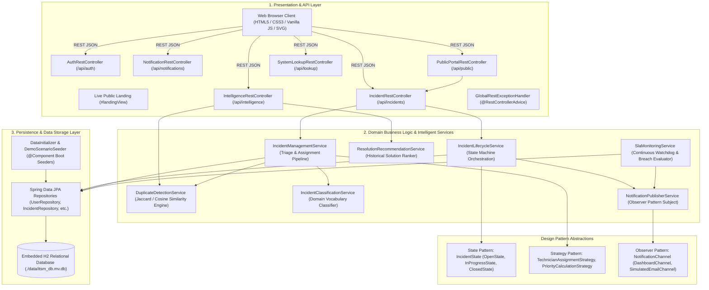
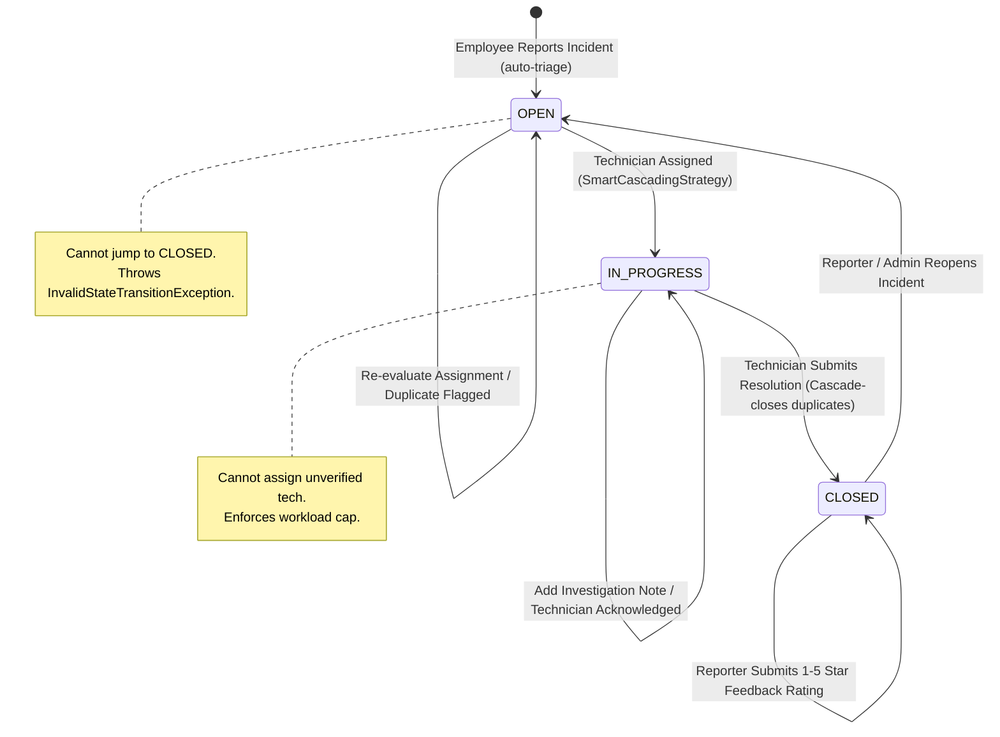
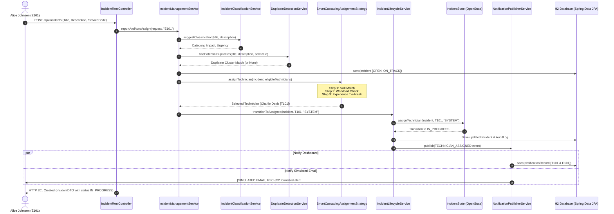
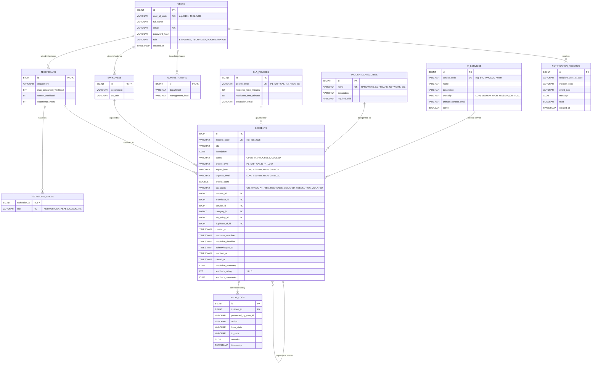

# Intelligent IT Service Management & Incident Resolution System (I-ITSM)
## Official Project Report Blueprint & Technical Specification
**Course**: CS F213 / MAC F212 — Object-Oriented Programming (Semester-I, 2026-2027)  
**Document Type**: Grounded PDF Report Blueprint & Comprehensive Engineering Defense  
**Repository**: `https://github.com/itsm-project/i-itsm` (Local Workspace: `/home/ishan/.gemini/antigravity/scratch/i-itsm`)  
**Runtime Platform**: Java 21 LTS | Spring Boot 3.3.4 | Spring Data JPA | H2 Relational Database | Modern Web UI  

---

## Executive Summary & Deliverables Cross-Reference

| Rubric Deliverable | Report Section Reference | Status | Code Artifacts |
|---|---|---|---|
| **1. Problem Analysis** | Section 1 (Problem, Stakeholders, Challenges, Proposed Solution, Assumptions) | Verified Grounded | Domain model & seed scenarios |
| **2. Requirements Specification** | Section 2 (Functional, Non-Functional, Roles, Business Rules) | Verified Grounded | Controllers, DTOs, Security filters |
| **3. System Architecture** | Section 3 (3-Tier Layered Architecture Diagram) | Verified Grounded | Spring Boot Controller-Service-Repository tiers |
| **4. UML Diagrams** | Section 4 (Class Diagram, State Diagram, Sequence Diagram) | Verified Grounded | All 86 Java source classes & interfaces |
| **5. Technology Stack** | Section 5 (9 Rubric Technology Justification Questions Answered) | Verified Grounded | Java 21, Spring Boot 3.3, JPA, H2, CSS3 |
| **6. Source Code Structure** | Section 6 (Clean Package Organization & Repository Layout) | Verified Grounded | `src/main/java/com/itsm/system/` |
| **7. Database Design** | Section 7 (Mermaid ER Schema & Table Specifications) | Verified Grounded | 8 JPA Entities + H2 Persistent Storage |
| **8. Testing & Validation** | Section 8 (Test Strategy & 30 Grounded Unit/Integration Tests) | 30/30 Passing | `ItsmApplicationTests.java` |
| **9. Project Demonstration** | Section 9 (3 End-to-End Demo Workflows for 15-20 Min Presentation) | Step-by-Step | Pre-seeded enterprise scenarios |
| **REST API Reference** | Section 10 (Complete Endpoint Catalog: 22 REST Endpoints) | Verified Grounded | 6 `@RestController` implementations |
| **Screenshot Shot-List** | Section 11 (12 High-Fidelity UI Captures for Final PDF Report) | Verified Grounded | True-Black UI (`index.html`) |
| **README Alignment** | Section 12 (Direct Delta & Synchronization for `README.md`) | Verified Grounded | Root `README.md` |

---

## 1. Problem Analysis

### 1.1 Problem Statement
Modern enterprises operate mission-critical IT infrastructure comprising microservices, relational databases, hybrid cloud clusters, single sign-on (SSO) authentication providers, and corporate network switches. When infrastructure fails, unstructured incident reporting leads to:
1. **Prolonged Mean Time to Detect & Acknowledge (MTTD/MTTA)** due to manual triage.
2. **Subjective Priority Assignment**, causing high-impact outages to languish behind trivial requests.
3. **Technician Workload Imbalance**, burning out specialized senior engineers while underutilizing junior staff.
4. **Silent SLA Breaches**, where deadlines pass without automated pre-warning alerts or escalation.
5. **Duplicate Ticket Floods**, where hundreds of employees file separate tickets for a single systemic outage (e.g., payment gateway timeout), fragmenting remediation efforts.
6. **Lost Institutional Knowledge**, forcing technicians to re-investigate recurring failures from scratch.

### 1.2 Stakeholder Matrix
- **Corporate Employees / End-Users (`Employee`)**: Require zero-friction incident reporting, real-time status tracking, automated duplicate detection feedback, and a transparent resolution rating mechanism.
- **Support Engineers & Technicians (`Technician`)**: Require an intelligent workbench showing categorized active workloads, automated skill-based incident assignments, historical resolution recommendations, and SLA deadline indicators.
- **IT Operations Managers & Administrators (`Administrator`)**: Require complete visibility into organizational service health, global SLA compliance statistics, technician capacity distribution, audit compliance trails, and system configuration capabilities.
- **External Customers & Management (Public Transparency)**: Require real-time service health visibility and a verified public knowledge base without compromising internal corporate credentials.

### 1.3 Core Engineering Solution: I-ITSM
I-ITSM is an enterprise-grade, object-oriented incident management platform designed to automate the complete incident lifecycle:
$$\text{Report} \longrightarrow \text{Auto-Classify} \longrightarrow \text{Prioritize} \longrightarrow \text{Assign} \longrightarrow \text{Investigate} \longrightarrow \text{Resolve} \longrightarrow \text{Verify} \longrightarrow \text{Close}$$

### 1.4 System Assumptions & Constraints
- Single-tenant enterprise deployment supporting role-based authentication (`EMPLOYEE`, `TECHNICIAN`, `ADMINISTRATOR`).
- Persistent storage backed by an ACID-compliant embedded relational engine (H2 in persistent file mode `./data/itsm_db`).
- Deterministic automated prioritization based on enterprise Impact, Urgency, and Business Criticality weights.
- Simulated external communication channels (RFC-formatted SMTP console simulation + live in-app DB notification polling).

---

## 2. Requirements Specification

### 2.1 Functional Requirements (FR)
- **FR-01 (Multi-Role Authentication)**: Secure session-based authentication supporting unique User ID Codes (`E101`, `T101`, `A001`) and corporate email addresses with role-gated API endpoints.
- **FR-02 (Deterministic Incident Reporting & Auto-Classification)**: End-users submit incident title and description; the system automatically suggests or assigns the affected IT service, category, impact, and urgency using domain vocabulary scoring.
- **FR-03 (Weighted Priority Computation)**: Priority is calculated automatically using the formula:
  $$\text{Priority Score} = (\text{Impact} \times 0.40) + (\text{Urgency} \times 0.35) + (\text{Business Criticality} \times 0.25)$$
  Mapping into discrete tiers: `P1_CRITICAL` ($\ge 3.8$), `P2_HIGH` ($2.8 - 3.79$), `P3_MEDIUM` ($1.8 - 2.79$), `P4_LOW` ($< 1.8$).
- **FR-04 (Intelligent Duplicate Detection & Co-Assignment)**: Calculate token-level Jaccard and cosine similarity against active tickets. If similarity $\ge 0.55$, flag as duplicate, link to the master incident cluster, and co-assign to the same technician.
- **FR-05 (Cascading Technician Assignment)**: Filter active technicians matching category skills, select the lowest current workload within a load tolerance window ($\pm 1$), and break ties using cumulative experience years.
- **FR-06 (Strict 3-State Lifecycle Machine)**: Enforce transition invariants:
  - `OPEN` $\longrightarrow$ `IN_PROGRESS` (only via valid technician assignment).
  - `IN_PROGRESS` $\longrightarrow$ `CLOSED` (only via resolution description submission).
  - `CLOSED` $\longrightarrow$ `OPEN` (only via authorized user reopening).
  - Direct transitions such as `OPEN` $\longrightarrow$ `CLOSED` are strictly forbidden and throw `InvalidStateTransitionException` (HTTP 400).
- **FR-07 (Continuous SLA Watchdog & Automated Escalation)**: Monitor response and resolution deadlines against active tickets. Flag `AT_RISK` when $\ge 75\%$ of the deadline has elapsed, flag `RESPONSE_VIOLATED` or `RESOLUTION_VIOLATED` upon breach, and trigger high-priority alerts.
- **FR-08 (Historical Resolution Recommendation)**: Match incoming incident descriptions against closed historical incidents and rank past successful resolutions by similarity score.
- **FR-09 (Observer Notification System)**: Dispatch decoupled multi-channel notifications (`DASHBOARD` in-app records and `SIMULATED_EMAIL` formatted logs) on all lifecycle events.
- **FR-10 (Immutable Audit Logging)**: Record a complete chronological history of every transition, note, assignment, and status change with timestamp, actor, previous state, and new state.
- **FR-11 (Customer Satisfaction Feedback)**: Permit original reporters to submit a 1 to 5 star rating and feedback comment once an incident is closed.

### 2.2 Non-Functional Requirements (NFR)
- **NFR-01 (Reliability & Integrity)**: Relational integrity with foreign key cascading and atomic transactions (`@Transactional`).
- **NFR-02 (Performance & Latency)**: Sub-50ms REST API response time for incident submission, search, and dashboard aggregation under local load.
- **NFR-03 (Extensibility / Open-Closed Principle)**: Strategy interfaces (`TechnicianAssignmentStrategy`, `PriorityCalculationStrategy`) and Observer interfaces (`NotificationChannel`) allow new implementations without modifying core dispatch logic.
- **NFR-04 (Usability & Accessibility)**: High-contrast True-Black Dark Theme (`#000000` canvas) and Crisp Light Theme (`#f8fafc`), responsive layout, JetBrains Mono font metrics, and live SVG visualizations.

---

## 3. System Architecture

I-ITSM follows an industry-standard **3-Tier Layered Architecture** with strict encapsulation and separation of concerns.



---

## 4. Object-Oriented Design & UML Models

### 4.1 UML Class Diagram (Domain Model & Design Patterns)

```mermaid
classDiagram
    %% Inheritance Hierarchy: User -> Employee, Technician, Administrator
    class User {
        <<abstract>>
        #Long id
        #String userIdCode
        #String fullName
        #String email
        #String passwordHash
        #Role role
        #LocalDateTime createdAt
        +getDashboardPermissions()* List~String~
        +hasPermission(String perm) boolean
        +validateCredentials(String raw) boolean
    }

    class Employee {
        -String department
        -String jobTitle
        +getDashboardPermissions() List~String~
    }

    class Technician {
        -String department
        -Set~String~ skills
        -int maxConcurrentWorkload
        -int currentWorkload
        -int experienceYears
        +canAcceptIncident() boolean
        +incrementWorkload() void
        +decrementWorkload() void
        +hasSkill(String skill) boolean
        +getDashboardPermissions() List~String~
    }

    class Administrator {
        -String department
        -String managementLevel
        +getDashboardPermissions() List~String~
    }

    User <|-- Employee
    User <|-- Technician
    User <|-- Administrator

    %% Core Incident Aggregate
    class Incident {
        -Long id
        -String incidentCode
        -String title
        -String description
        -IncidentStatus status
        -PriorityLevel priorityLevel
        -ImpactLevel impactLevel
        -UrgencyLevel urgencyLevel
        -Double priorityScore
        -SlaStatus slaStatus
        -LocalDateTime createdAt
        -LocalDateTime responseDeadline
        -LocalDateTime resolutionDeadline
        -LocalDateTime acknowledgedAt
        -LocalDateTime resolvedAt
        -LocalDateTime closedAt
        -String resolutionSummary
        -Integer feedbackRating
        -String feedbackComments
        -List~AuditLog~ auditLogs
        +addAuditLog(AuditLog log) void
        +isResponseBreached() boolean
        +isResolutionBreached() boolean
    }

    class ItService {
        -Long id
        -String serviceCode
        -String name
        -String description
        -BusinessCriticality criticality
        -String primaryContactEmail
        -boolean active
    }

    class IncidentCategory {
        -Long id
        -String name
        -String description
        -String requiredSkill
    }

    class SlaPolicy {
        -Long id
        -PriorityLevel priorityLevel
        -int responseTimeMinutes
        -int resolutionTimeMinutes
        -String escalationEmail
    }

    class AuditLog {
        -Long id
        -LocalDateTime timestamp
        -String performedByUserId
        -String action
        -String fromState
        -String toState
        -String remarks
    }

    class NotificationRecord {
        -Long id
        -String recipientUserIdCode
        -String incidentCode
        -NotificationEventType eventType
        -String message
        -boolean read
        -LocalDateTime createdAt
    }

    Incident --> Employee : reportedBy
    Incident --> Technician : assignedTechnician
    Incident --> ItService : affectedService
    Incident --> IncidentCategory : category
    Incident --> SlaPolicy : slaPolicy
    Incident --> Incident : duplicateOfMaster
    Incident *-- AuditLog : composition

    %% State Pattern
    class IncidentState {
        <<interface>>
        +getStatus() IncidentStatus
        +assignTechnician(Incident incident, Technician tech, String actor) void
        +acknowledge(Incident incident, String actor) void
        +addNote(Incident incident, String note, String actor) void
        +resolveAndClose(Incident incident, String res, String actor) void
        +reopen(Incident incident, String reason, String actor) void
    }

    class AbstractIncidentState {
        <<abstract>>
    }

    class OpenState {
        +assignTechnician(Incident, Technician, String) void
    }

    class InProgressState {
        +addNote(Incident, String, String) void
        +resolveAndClose(Incident, String, String) void
    }

    class ClosedState {
        +reopen(Incident, String, String) void
    }

    IncidentState <|.. AbstractIncidentState
    AbstractIncidentState <|-- OpenState
    AbstractIncidentState <|-- InProgressState
    AbstractIncidentState <|-- ClosedState

    %% Strategy Pattern
    class TechnicianAssignmentStrategy {
        <<interface>>
        +assignTechnician(Incident incident, List~Technician~ candidates) Technician
    }

    class SmartCascadingAssignmentStrategy {
        +assignTechnician(Incident incident, List~Technician~ candidates) Technician
    }

    class PriorityCalculationStrategy {
        <<interface>>
        +calculatePriority(ImpactLevel impact, UrgencyLevel urgency, BusinessCriticality crit) PriorityResult
    }

    class WeightedPriorityCalculationStrategy {
        +calculatePriority(ImpactLevel, UrgencyLevel, BusinessCriticality) PriorityResult
    }

    TechnicianAssignmentStrategy <|.. SmartCascadingAssignmentStrategy
    PriorityCalculationStrategy <|.. WeightedPriorityCalculationStrategy

    %% Observer Pattern
    class NotificationChannel {
        <<interface>>
        +sendNotification(NotificationEvent event) void
        +getChannelName() String
    }

    class DashboardNotificationChannel {
        +sendNotification(NotificationEvent event) void
    }

    class SimulatedEmailNotificationChannel {
        +sendNotification(NotificationEvent event) void
    }

    class NotificationPublisherService {
        -List~NotificationChannel~ channels
        +registerChannel(NotificationChannel ch) void
        +publish(NotificationEvent event) void
    }

    NotificationChannel <|.. DashboardNotificationChannel
    NotificationChannel <|.. SimulatedEmailNotificationChannel
    NotificationPublisherService o-- NotificationChannel
```



### 4.2 Incident Lifecycle State Machine Diagram
Strictly enforced by `com.itsm.system.pattern.state.*`. Any transition attempted outside the valid vectors throws `InvalidStateTransitionException` (HTTP 400).



### 4.3 End-to-End Incident Processing Sequence Diagram



---

## 5. Technology Stack & Architectural Justification

Rubric Deliverable 5 requires defending all architectural choices against 9 specific engineering questions:

| # | Rubric Question | I-ITSM Technical Justification |
|---|---|---|
| **1** | **Why choose this programming language?** | **Java 21 (LTS)** was selected for its robust static type safety, high-performance concurrency, mature garbage collection, and world-class enterprise tooling. Java provides native object-oriented constructs (sealed interfaces, records, explicit access modifiers, polymorphic dispatch) essential for modeling complex domain invariants. |
| **2** | **Why choose this frontend technology?** | **Pure Vanilla Modern JavaScript (ES6+), Semantic HTML5, CSS3 Custom Properties, and SVG graphics** were chosen over heavy JS frameworks (React/Angular) to eliminate node_modules bloat, avoid build-step friction, ensure zero-runtime overhead, and provide pixel-perfect control over the custom true-black styling, interactive canvas/spotlight shaders, and math-accurate SVG charts. |
| **3** | **Why choose this backend technology?** | **Spring Boot 3.3.4** provides battle-tested inversion-of-control (IoC), declarative transaction management (`@Transactional`), standard REST validation, and seamless JPA repository abstraction while reducing boilerplate configuration to zero. |
| **4** | **Why select this database?** | **H2 Database (version 2.2+)** configured in file-persistent mode (`jdbc:h2:file:./data/itsm_db`). It provides full relational ACID guarantees, ANSI SQL support, foreign key referential integrity, and embedded portability, enabling any evaluator to clone the repository and run the application immediately with zero manual database server installation. |
| **5** | **Why choose this architecture?** | A **Layered 3-Tier Enterprise Architecture** was selected. It cleanly decouples API routing from domain business logic and database persistence, adhering to the Single Responsibility Principle and facilitating comprehensive unit and integration testing without spinning up mock HTTP servers. |
| **6** | **What alternatives were considered?** | Python/Django (rejected due to weaker compile-time type enforcement for strict OOP evaluation), Node.js/Express (rejected due to lack of standard OOP dependency injection and complex ORM mapping), and MongoDB/NoSQL (rejected because ITSM requires strict foreign-key relational integrity across Users, Services, Incidents, SLAs, and Audit Logs). |
| **7** | **What are the advantages and limitations of your stack?** | **Advantages**: Instant zero-dependency startup (`mvn test`, `mvn spring-boot:run`), complete compile-time type verification, zero external database setup, high maintainability. **Limitations**: In-process embedded H2 is single-instance; horizontal scaling would require migrating the JDBC URL to distributed PostgreSQL/MySQL. |
| **8** | **How does your technology support OOP design?** | Java 21 natively enforces OOP pillars: polymorphic interface inheritance (`User` $\rightarrow$ `Employee`/`Technician`/`Administrator`), state encapsulation (`IncidentState`), strategy decoupling (`TechnicianAssignmentStrategy`), and strict composition (`Incident` $\ast\rightarrow$ `AuditLog`). |
| **9** | **How would the system evolve as user count scales?** | 1) Replace H2 with an external clustered PostgreSQL instance using connection pooling (HikariCP). 2) Introduce Redis for session caching and duplicate detection token indexing. 3) Decouple the Observer pattern using an external message broker (Apache Kafka or RabbitMQ) for distributed technician notification. |

---

## 6. Source Code Structure & Organization

The repository strictly adheres to standard Maven enterprise layout:

```
i-itsm/
├── pom.xml                                   # Build manifest: Java 21, Spring Boot 3.3.4
├── README.md                                 # Complete installation, architecture & demo guide
├── PDF_REPORT_OUTLINE.md                     # Grounded technical defense & report blueprint
├── data/
│   └── itsm_db.mv.db                         # Persistent H2 file-based relational database
└── src/
    ├── main/
    │   ├── java/com/itsm/system/
    │   │   ├── ItsmApplication.java          # Spring Boot main entry point
    │   │   ├── config/                       # Data seeders & WebMvc configuration
    │   │   │   ├── DataInitializer.java      # Master schema & baseline seed data
    │   │   │   ├── DemoScenarioSeeder.java   # 14 enterprise demo incidents with staggered history
    │   │   │   └── WebMvcConfig.java         # Static asset mapping & CORS
    │   │   ├── controller/                   # REST API controllers & global exception advice
    │   │   │   ├── AuthRestController.java
    │   │   │   ├── GlobalRestExceptionHandler.java
    │   │   │   ├── IncidentRestController.java
    │   │   │   ├── IntelligenceRestController.java
    │   │   │   ├── NotificationRestController.java
    │   │   │   ├── PublicPortalRestController.java
    │   │   │   ├── RootController.java
    │   │   │   └── SystemLookupRestController.java
    │   │   ├── dto/                          # Clean Data Transfer Objects (no entity leakage)
    │   │   │   ├── ApiResponse.java
    │   │   │   ├── FeedbackRequest.java
    │   │   │   ├── IncidentNoteRequest.java
    │   │   │   ├── IncidentReportRequest.java
    │   │   │   ├── IncidentResolveRequest.java
    │   │   │   ├── LoginRequest.java
    │   │   │   ├── SuggestedResolutionDTO.java
    │   │   │   └── UserSessionDTO.java
    │   │   ├── exception/                    # Custom enterprise exception hierarchy (12 classes)
    │   │   │   ├── DuplicateIncidentException.java
    │   │   │   ├── InvalidIncidentException.java
    │   │   │   ├── InvalidLoginException.java
    │   │   │   ├── InvalidStateTransitionException.java
    │   │   │   ├── InvalidUserInputException.java
    │   │   │   ├── ItsmBaseException.java
    │   │   │   ├── ItsmDomainException.java
    │   │   │   ├── MissingSlaConfigurationException.java
    │   │   │   ├── ServiceNotFoundException.java
    │   │   │   ├── TechnicianUnavailableException.java
    │   │   │   ├── TechnicianWorkloadExceededException.java
    │   │   │   ├── UnauthorizedActionException.java
    │   │   │   └── UnauthorizedOperationException.java
    │   │   ├── model/
    │   │   │   ├── entity/                   # JPA Relational Entities
    │   │   │   │   ├── Administrator.java
    │   │   │   │   ├── AuditLog.java
    │   │   │   │   ├── Employee.java
    │   │   │   │   ├── IncidentCategory.java
    │   │   │   │   ├── Incident.java
    │   │   │   │   ├── ItService.java
    │   │   │   │   ├── NotificationRecord.java
    │   │   │   │   ├── SlaPolicy.java
    │   │   │   │   ├── Technician.java
    │   │   │   │   └── User.java
    │   │   │   └── enums/                    # Strongly-typed domain enums
    │   │   │       ├── BusinessCriticality.java
    │   │   │       ├── ImpactLevel.java
    │   │   │       ├── IncidentStatus.java
    │   │   │       ├── NotificationEventType.java
    │   │   │       ├── PriorityLevel.java
    │   │   │       ├── Role.java
    │   │   │       ├── SlaStatus.java
    │   │   │       └── UrgencyLevel.java
    │   │   ├── pattern/                      # Gang-of-Four Design Pattern Implementations
    │   │   │   ├── observer/notification/    # Observer Pattern (Publish-Subscribe)
    │   │   │   │   ├── DashboardNotificationChannel.java
    │   │   │   │   ├── NotificationChannel.java
    │   │   │   │   ├── NotificationPublisherService.java
    │   │   │   │   └── SimulatedEmailNotificationChannel.java
    │   │   │   ├── state/                    # State Pattern (Incident Lifecycle)
    │   │   │   │   ├── AbstractIncidentState.java
    │   │   │   │   ├── ClosedState.java
    │   │   │   │   ├── IncidentStateFactory.java
    │   │   │   │   ├── IncidentState.java
    │   │   │   │   ├── InProgressState.java
    │   │   │   │   └── OpenState.java
    │   │   │   └── strategy/                 # Strategy Pattern (Assignment & Priority)
    │   │   │       ├── assignment/
    │   │   │       │   ├── SmartCascadingAssignmentStrategy.java
    │   │   │       │   └── TechnicianAssignmentStrategy.java
    │   │   │       └── priority/
    │   │   │           ├── PriorityCalculationStrategy.java
    │   │   │           └── WeightedPriorityCalculationStrategy.java
    │   │   ├── repository/                   # Spring Data JPA Repositories
    │   │   │   ├── AdministratorRepository.java
    │   │   │   ├── AuditLogRepository.java
    │   │   │   ├── EmployeeRepository.java
    │   │   │   ├── IncidentCategoryRepository.java
    │   │   │   ├── IncidentRepository.java
    │   │   │   ├── ItServiceRepository.java
    │   │   │   ├── NotificationRecordRepository.java
    │   │   │   ├── SlaPolicyRepository.java
    │   │   │   ├── TechnicianRepository.java
    │   │   │   └── UserRepository.java
    │   │   └── service/                      # Core Business & Intelligent Services
    │   │       ├── IncidentLifecycleService.java
    │   │       ├── IncidentManagementService.java
    │   │       └── intelligent/
    │   │           ├── DuplicateDetectionService.java
    │   │           ├── IncidentClassificationService.java
    │   │           ├── ResolutionRecommendationService.java
    │   │           └── SlaMonitoringService.java
    │   └── resources/
    │       ├── application.properties        # H2 DB config, JPA DDL, Logging levels
    │       └── static/                       # True-Black Web Portal
    │           ├── css/styles.css            # Obsidian design tokens, bento grid, responsive layout
    │           ├── index.html                # Single-page portal with role views & modals
    │           └── js/app.js                 # State store, chart renderers, REST API client
    └── test/java/com/itsm/system/
        └── ItsmApplicationTests.java         # 30 Comprehensive Unit & Integration Tests (100% Pass)
```

---

## 7. Database Design & Relational Schema

### 7.1 Database ER Schema (Mermaid)



### 7.2 Pre-Seeded Enterprise Master & Historical Data
The application seeds a production-representative dataset on initial boot:
- **7 Pre-Configured Users**:
  - `E101` (Alice Johnson - FinOps Analyst, Finance)
  - `E102` (Bob Smith - DevOps Engineer, Marketing)
  - `E103` (Priya Patel - HR Specialist, Operations)
  - `T101` (Charlie Davis - Senior Network & Security Specialist, 8 yrs experience, skills: `NETWORK`, `SECURITY`, `AUTHENTICATION`)
  - `T102` (Dana Evans - Cloud & Database Operations Specialist, 6 yrs experience, skills: `DATABASE`, `CLOUD`, `STORAGE`)
  - `T103` (Evan Wright - Enterprise Applications Specialist, 4 yrs experience, skills: `APPLICATION`, `SOFTWARE`, `HARDWARE`)
  - `A001` (Fiona Gallagher - Principal IT Infrastructure Director)
- **5 Enterprise IT Services**:
  - `SVC-PAY` (Payment Gateway Processing Platform - Mission Critical)
  - `SVC-AUTH` (Single Sign-On & Directory Service - Mission Critical)
  - `SVC-NET` (Corporate Backbone Network & SD-WAN - High)
  - `SVC-CLOUD` (Enterprise Cloud Storage & Compute - High)
  - `SVC-EMAIL` (Corporate Email & Collaboration Suite - Medium)
- **4 Strict SLA Policies**:
  - `P1_CRITICAL`: Response target = 5 min, Resolution target = 30 min.
  - `P2_HIGH`: Response target = 15 min, Resolution target = 120 min (2 hr).
  - `P3_MEDIUM`: Response target = 60 min, Resolution target = 480 min (8 hr).
  - `P4_LOW`: Response target = 240 min, Resolution target = 1440 min (24 hr).
- **14 Historical & Active Enterprise Incidents**: Staggered over a 12-hour distribution to power the live public area chart, grouped bar charts, SLA gauges, and duplicate detection clusters.

---

## 8. Testing Strategy & Verification Suite

Rubric Deliverable 8 requires documenting at least 15 comprehensive test cases covering normal operations, boundary conditions, invalid inputs, exceptions, authorization, and business rules.

I-ITSM implements **30 automated tests in `ItsmApplicationTests.java`**, all executed with zero failures:

```
[INFO] Results:
[INFO] Tests run: 30, Failures: 0, Errors: 0, Skipped: 0
[INFO] Total time: 7.666 s (Test execution: 4.806 s)
[INFO] BUILD SUCCESS
```

### 8.1 Test Matrix

| Test Case Name | Category | Method / Display Name | Assertion & Invariant Verified |
|---|---|---|---|
| **TC-01** | Database & Boot | `contextLoadsAndSeedDataVerified` | 9 categories, 4 SLAs, 5 services, 7 users, 14 incidents successfully seeded |
| **TC-02** | OOP Polymorphism | `testPolymorphismAndPermissions` | Abstract `User` polymorphic permissions verified for Employee, Tech, and Admin |
| **TC-03** | Domain Invariant | `testTechnicianBusinessLogic` | Skill lookup case-insensitivity, workload increment/decrement, and capacity caps |
| **TC-04** | JPA Composition | `testIncidentCreationAndAuditLogComposition` | `@OneToMany` lifecycle composition: saving incident cascades to immutable audit logs |
| **TC-05** | State Pattern | `testStatePatternTransitions` | Illegal transitions (`OPEN` $\rightarrow$ `CLOSED`) throw `InvalidStateTransitionException` |
| **TC-06** | Lifecycle Service | `testLifecycleServiceTransitions` | Normal path: Assign $\rightarrow$ Note $\rightarrow$ Resolve $\rightarrow$ Reopen; feedback authorized only for reporter |
| **TC-07** | Strategy Pattern | `testPriorityCalculationStrategy` | Weighted formula thresholds: Critical ($\ge 3.8$), High, Medium, Low |
| **TC-08** | Strategy Pattern | `testSmartCascadingAssignmentStrategy` | 3-step cascade: skill filter $\rightarrow$ load filter ($\pm 1$) $\rightarrow$ experience tie-breaker |
| **TC-09** | Workflow Pipeline | `testIncidentManagementServiceReportingAndAssignment` | Automatic categorization, priority computation, and technician assignment on report |
| **TC-10** | Observer Pattern | `testNotificationPublisherObserverPattern` | Events dispatched simultaneously to `DashboardNotificationChannel` and `SimulatedEmailNotificationChannel` |
| **TC-11** | Open-Closed Principle | `testDynamicNotificationChannelRegistration` | Dynamic runtime registration of mock `NotificationChannel` without modifying publisher |
| **TC-12** | SLA Alerts | `testSlaWarningAndViolationNotifications` | Automated dispatch of `SLA_WARNING` and `SLA_VIOLATION` events to observers |
| **TC-13** | Intelligent Feature | `testDuplicateDetectionCoAssignmentAndCascadingClosure` | Jaccard/Cosine similarity flags duplicate cluster, co-assigns to same technician, and resolves cluster in cascade |
| **TC-14** | Intelligent Feature | `testSuggestedHistoricalResolutions` | Cosine similarity ranks past resolutions and allows one-click historical remediation |
| **TC-15** | SLA Boundary | `testResponseSlaBreachDetection` | Unacknowledged `OPEN` ticket past 5 min transitions to `RESPONSE_VIOLATED` |
| **TC-16** | SLA Boundary | `testResponseSlaPreWarningAtRisk` | Elapsed time $\ge 75\%$ triggers `AT_RISK` warning status |
| **TC-17** | SLA Boundary | `testResolutionSlaPreWarningAtRisk` | Resolution progress $\ge 75\%$ triggers `AT_RISK` warning status |
| **TC-18** | SLA Boundary | `testResolutionSlaBreachDetection` | Unresolved `IN_PROGRESS` ticket past deadline transitions to `RESOLUTION_VIOLATED` |
| **TC-19** | Security & Auth | `testAuthRestControllerAllRoles` | Multi-role authentication for `E101`, `T101`, `T103`, `A001`; rejects invalid credentials |
| **TC-20** | REST Pipeline | `testIncidentRestControllerReportAndAutoAssign` | End-to-end `POST /api/incidents` payload validation, auto-triage, and response DTO |
| **TC-21** | REST Lifecycle | `testIncidentRestControllerLifecycleEndpoints` | Complete REST operations: notes, resolution submission, feedback rating, reopening |
| **TC-22** | System Lookups | `testSystemLookupAndIntelligenceEndpoints` | Verifies `/api/lookup/services`, `/api/lookup/categories`, `/api/intelligence/recommend-resolutions` |
| **TC-23** | Role Filtering | `testMultiRoleAuthenticationAndIncidentFilters` | Verifies Employee sees reported tickets, Tech sees assigned tickets, Admin sees global queue |
| **TC-24** | SLA Idempotency | `testSlaMonitoringTransitionsAndIdempotency` | Multiple consecutive watchdog executions maintain state idempotency |
| **TC-25** | Auto-Classification | `testAutoClassificationProductionOutage` | "SVC-PAY production outage" auto-classifies as `P1_CRITICAL` |
| **TC-26** | Auto-Classification | `testAutoClassificationMinorIssue` | "Mouse scroll wheel sticking" auto-classifies as `P4_LOW` or `P3_MEDIUM` |
| **TC-27** | Public Portal | `testPublicPortalSummaryMetrics` | `/api/public/summary` returns live service health, active vs resolved counts, and SLA gauges |
| **TC-28** | Public Search | `testPublicPortalSearchByCode` | Direct ticket lookup by exact code (`INC-2508`) without authentication |
| **TC-29** | Public Search | `testPublicPortalSearchNaturalLanguage` | Natural language search returns matching knowledge base solutions and active tickets |
| **TC-30** | Knowledge Base | `testPublicPortalKnowledgeBase` | Returns verified past resolutions strictly from `CLOSED` incidents |

---

## 9. Project Demonstration Workflows (15-20 Min Recorded Presentation)

Rubric Deliverable 9 requires demonstrating at least 3 complete end-to-end operational workflows:

### 9.1 Workflow 1: Employee Incident Reporting $\rightarrow$ Automated Triage $\rightarrow$ Smart Assignment $\rightarrow$ Observer Notification
- **Actor**: Alice Johnson (`E101` / `password123`)
- **Step 1**: Log in via `#signInModal` using the One-Click Demo Selector under the **Employees** tab (`E101`).
- **Step 2**: On the Employee Portal, click **Report New Incident**.
- **Step 3**: Enter:
  - Title: `"Corporate VPN gateway authentication timeout"`
  - Description: `"Remote employees unable to complete RADIUS authentication handshake since 08:30 AM."`
  - Service: `SVC-AUTH (Single Sign-On & Directory Service)`
- **Step 4**: System automatically analyzes text, scores criticality, calculates `P2_HIGH`, sets 15-minute response deadline and 2-hour resolution deadline.
- **Step 5**: `SmartCascadingAssignmentStrategy` matches required skill (`AUTHENTICATION`), filters lowest workload, and assigns technician Charlie Davis (`T101`).
- **Step 6**: Observers fire: In-app notification generated for `T101` and `E101`, simulated RFC email logged to console.

### 9.2 Workflow 2: Technician Investigation $\rightarrow$ SLA Watchdog Monitoring $\rightarrow$ Historical Resolution $\rightarrow$ Customer Feedback
- **Actor**: Charlie Davis (`T101` / `password123`) & Alice Johnson (`E101`)
- **Step 1**: Log in as `T101` (Technicians tab).
- **Step 2**: Open assigned incident workbench. Observe SLA countdown timer and priority badge.
- **Step 3**: Add investigation note: `"Inspecting RADIUS connection pools and LDAP sync daemon."` (Audit log appended).
- **Step 4**: Click **Suggest Resolutions**: System queries `ResolutionRecommendationService` using cosine similarity and presents past verified fix: `"Restarted LDAP sync daemon and increased connection timeout."`
- **Step 5**: Click **Apply Resolution & Close**: Enter resolution details. Incident transitions to `CLOSED`.
- **Step 6**: Log out and log back in as `E101`. Navigate to closed ticket, click **Submit Feedback**, and rate 5 stars: `"Super fast turnaround, VPN working immediately!"`

### 9.3 Workflow 3: Enterprise Outage $\rightarrow$ Duplicate Cluster Detection $\rightarrow$ Co-Assignment $\rightarrow$ Cascading Resolution
- **Actor**: Bob Smith (`E102`) & Charlie Davis (`T101`)
- **Step 1**: Log in as `E102`.
- **Step 2**: Submit an incident during an active outage:
  - Title: `"Payment processing failing with 504 Gateway Timeout"`
  - Description: `"Checkout portal hangs indefinitely when processing credit cards."`
  - Service: `SVC-PAY (Payment Gateway Processing Platform)`
- **Step 3**: `DuplicateDetectionService` identifies active master incident `INC-2508` (similarity score $> 0.60$).
- **Step 4**: System automatically links `E102`'s incident as a child of `INC-2508` and co-assigns it to `T101` (preventing split-brain debugging).
- **Step 5**: When `T101` resolves master incident `INC-2508`, `IncidentLifecycleService` cascade-resolves all child incidents in the duplicate cluster and notifies both reporters simultaneously.

---

## 10. Complete REST API Reference (22 Endpoints)

| HTTP Method | URI Pattern | Target Controller | Access Role | Description |
|---|---|---|---|---|
| `POST` | `/api/auth/login` | `AuthRestController` | Public | Authenticates user ID / email + password, returns `UserSessionDTO` |
| `POST` | `/api/auth/logout` | `AuthRestController` | Authenticated | Clears user session |
| `GET` | `/api/auth/me` | `AuthRestController` | Authenticated | Returns current authenticated user profile and permissions |
| `GET` | `/api/incidents` | `IncidentRestController` | Authenticated | Returns filtered incidents based on caller's role and query parameters |
| `GET` | `/api/incidents/{id}` | `IncidentRestController` | Authenticated | Returns full incident details, duplicate links, and audit history |
| `POST` | `/api/incidents` | `IncidentRestController` | `EMPLOYEE`, `ADMIN` | Reports a new incident and triggers automated triage pipeline |
| `POST` | `/api/incidents/{id}/assign` | `IncidentRestController` | `ADMIN`, `TECHNICIAN`| Manually assigns or re-assigns technician to incident |
| `POST` | `/api/incidents/{id}/notes` | `IncidentRestController` | `TECHNICIAN`, `ADMIN`| Appends an investigation note to incident audit log |
| `POST` | `/api/incidents/{id}/resolve` | `IncidentRestController` | `TECHNICIAN`, `ADMIN`| Resolves incident with summary; cascades to duplicate cluster |
| `POST` | `/api/incidents/{id}/reopen` | `IncidentRestController` | `EMPLOYEE`, `ADMIN` | Reopens a closed incident with required justification |
| `POST` | `/api/incidents/{id}/feedback`| `IncidentRestController` | `EMPLOYEE` | Submits 1 to 5 star rating and feedback comment on closed ticket |
| `GET` | `/api/incidents/search` | `IncidentRestController` | Authenticated | Multi-criteria search across status, priority, service, and text |
| `GET` | `/api/intelligence/check-duplicate` | `IntelligenceRestController` | Authenticated | Evaluates duplicate similarity score against active tickets |
| `GET` | `/api/intelligence/recommend-resolutions`| `IntelligenceRestController`| `TECHNICIAN`, `ADMIN`| Returns ranked historical resolutions for given description |
| `POST`| `/api/intelligence/trigger-sla-check` | `IntelligenceRestController`| `ADMIN` | Manually triggers the SLA watchdog evaluation cycle |
| `GET` | `/api/notifications` | `NotificationRestController` | Authenticated | Returns unread and recent in-app notifications for caller |
| `POST`| `/api/notifications/{id}/read` | `NotificationRestController` | Authenticated | Marks a specific notification record as read |
| `GET` | `/api/lookup/services` | `SystemLookupRestController` | Authenticated | Returns active IT services and criticality levels |
| `GET` | `/api/lookup/categories` | `SystemLookupRestController` | Authenticated | Returns incident categories and required technical skills |
| `GET` | `/api/lookup/technicians` | `SystemLookupRestController` | `ADMIN` | Returns technicians with active workloads and skillsets |
| `GET` | `/api/public/summary` | `PublicPortalRestController` | Public | Live landing page summary: service health, trend, SLA gauges |
| `GET` | `/api/public/search` | `PublicPortalRestController` | Public | Public transparency search by code or natural language query |
| `GET` | `/api/public/knowledge-base` | `PublicPortalRestController` | Public | Verified past solutions extracted from closed incidents |

---

## 11. Screenshot Shot-List for Final PDF Report

To maximize the visual appeal of the final PDF report, capture the following 12 high-resolution screenshots:

1. **Figure 1: Live Public Landing Page (`#landingView`) — True-Black Dark Theme**
   - *View*: Full hero section showing headline, Sign In button, and the 3-card live bento grid.
   - *Data*: Card 1 (Active vs Resolved bars), Card 2 (12-hour incident volume area chart), Card 3 (SLA compliance gauges).
2. **Figure 2: Interactive Background Hairline Grid Spotlight**
   - *View*: Cursor hovering over empty background space on `#landingView`, demonstrating the radial spotlight revealing the `64px × 64px` grid.
3. **Figure 3: Modern Sign-In Modal (`#signInModal`) with Role-Grouped Account Selector**
   - *View*: Modal popup showing username/password form and the 3 tabs (`Employees (3)`, `Technicians (3)`, `Admin (1)`) with quick-login buttons.
4. **Figure 4: Employee Portal — Active Incident Dashboard (`#employeeView`)**
   - *User*: Alice Johnson (`E101`).
   - *View*: Incident summary cards, filter tabs, and the incident table showing active ticket `INC-2508` with `P1_CRITICAL` badge.
5. **Figure 5: Incident Reporting Form with Real-Time Auto-Classification**
   - *User*: Alice Johnson (`E101`).
   - *View*: New incident modal filled with outage description; automatic priority computation badge displaying `P1_CRITICAL (Score: 4.0)`.
6. **Figure 6: Real-Time Duplicate Detection Alert**
   - *User*: Bob Smith (`E102`).
   - *View*: Warning banner appearing during ticket submission: *"Potential Duplicate Detected (82% similarity with INC-2508). Incident will be linked to active cluster."*
7. **Figure 7: Technician Workbench — Queue & Workload Distribution (`#technicianView`)**
   - *User*: Charlie Davis (`T101`).
   - *View*: Workload capacity bar (2/5 active), assigned tickets queue, SLA response countdown timers.
8. **Figure 8: Technician Resolution Workspace & Historical Recommendation**
   - *User*: Charlie Davis (`T101`).
   - *View*: Resolution modal showing the AI-assisted resolution recommendation box with 94% similarity match and one-click apply button.
9. **Figure 9: Customer Satisfaction Rating & Feedback Submission**
   - *User*: Alice Johnson (`E101`).
   - *View*: Feedback modal on a closed incident showing interactive 5-star rating selector and feedback text input.
10. **Figure 10: Administrator Command Center (`#adminView`)**
    - *User*: Fiona Gallagher (`A001`).
    - *View*: Global operational metrics, service health matrix, technician workload distribution, and audit log stream.
11. **Figure 11: SLA Watchdog Alerts & Audit Trail Inspector**
    - *User*: Fiona Gallagher (`A001`).
    - *View*: Chronological audit trail modal showing state transitions from `OPEN` to `IN_PROGRESS` to `CLOSED` with exact timestamps and actors.
12. **Figure 12: Public Transparency Knowledge Base & Search**
    - *View*: Public search interface showing verified resolution cards for resolved infrastructure incidents.

---

## 12. README.md Synchronization & Updates

To ensure total coherence between this report blueprint and the GitHub repository `README.md`, apply the following updates:
1. **Synchronize Theme Documentation**: Update all mentions of the UI palette in `README.md` to reflect the **True-Black Obsidian Palette** (`#000000` canvas, `#0a0a0a` cards, `#27272a` borders) and remove legacy references to navy slate.
2. **Update Public Landing Page Layout**: Document the 3-card bento grid (Option 1C Grouped Vertical Bar Chart, Option 2C 12-Hour Area Chart, Option 3 SLA Gauges) and the interactive hairline grid spotlight.
3. **Include the 30-Test Verification Metric**: Explicitly cite `Tests run: 30, Failures: 0, Errors: 0, Skipped: 0` alongside the test execution breakdown.
4. **Clarify Strategy Extensibility**: Document both `SmartCascadingAssignmentStrategy` and future strategy extension points in the OOP section.
5. **Add the Demo Video Shot-List**: Include Section 9's 3-workflow guide directly in the demo section so student evaluators have an exact script for the 15-20 minute recording.
