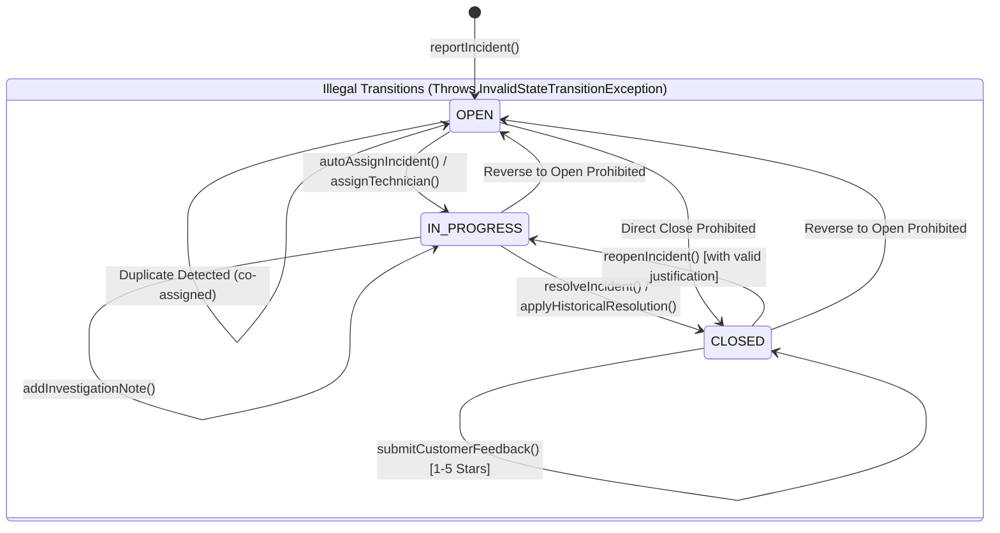

# Intelligent IT Service Management & Incident Resolution System (I-ITSM)

A modular, enterprise-grade IT Service Management (ITSM) and automated incident resolution platform built with **Java 17/21**, **Spring Boot 3.3.4**, **Spring Data JPA / Hibernate**, an embedded **H2 Database**, and a responsive **Vanilla JavaScript + Bootstrap 5** Single-Page Application (SPA).

I-ITSM implements production-grade object-oriented architecture and Gang of Four (GoF) design patterns to enforce strict lifecycle state machines, automated multi-tier technician assignment, priority matrix calculation, proactive SLA breach monitoring, duplicate ticket clustering, and historical resolution recommendations.

---

## Architecture & Technology Stack

- **Backend Framework:** Spring Boot 3.3.4 (`spring-boot-starter-web`, `spring-boot-starter-data-jpa`, `spring-boot-starter-validation`)
- **Language / Runtime:** Java 17+ (Compiled and tested on Java 21)
- **Persistence & ORM:** Spring Data JPA, Hibernate 6, H2 Database (file-persisted at `./data/itsm_db`)
- **Frontend Architecture:** Vanilla JavaScript (ES6+), Bootstrap 5.3 (via CDN), Bootstrap Icons, Dual-Theme CSS (Light & Dark mode)
- **Testing Suite:** JUnit 5, Spring Boot Starter Test (26 automated integration and domain tests)
- **Build Tool:** Apache Maven 3.8+

---

## Directory & Package Structure

```text
i-itsm/
├── pom.xml
├── .gitignore
├── LICENSE
├── README.md
├── data/                                 # File-persisted H2 database files (gitignored)
└── src/
    ├── main/
    │   ├── java/com/itsm/system/
    │   │   ├── ItsmApplication.java       # Spring Boot main entry point
    │   │   ├── config/
    │   │   │   ├── DataInitializer.java   # Order(1): Base categories, SLAs, IT services, demo users
    │   │   │   ├── DemoScenarioSeeder.java# Order(2): Realistic incidents, duplicate clusters, history
    │   │   │   ├── Phase2VerificationRunner.java  # Diagnostic runners (gated behind itsm.verification.runners.enabled)
    │   │   │   ├── Phase3VerificationRunner.java
    │   │   │   ├── Phase4AVerificationRunner.java
    │   │   │   ├── Phase4BVerificationRunner.java
    │   │   │   ├── Phase4CVerificationRunner.java
    │   │   │   └── WebMvcConfig.java      # Static resource routing
    │   │   ├── controller/
    │   │   │   ├── AuthRestController.java             # /api/auth
    │   │   │   ├── IncidentRestController.java         # /api/incidents
    │   │   │   ├── IntelligenceRestController.java     # /api/intelligence
    │   │   │   ├── NotificationRestController.java     # /api/notifications
    │   │   │   ├── RootController.java                 # "/" forward to "/index.html"
    │   │   │   ├── SystemLookupRestController.java     # /api/lookup
    │   │   │   └── GlobalRestExceptionHandler.java     # Standardized JSON error handler
    │   │   ├── dto/
    │   │   │   ├── ApiResponse.java                    # Standard envelope { success, message, data, timestamp }
    │   │   │   ├── FeedbackRequest.java
    │   │   │   ├── IncidentNoteRequest.java
    │   │   │   ├── IncidentReportRequest.java
    │   │   │   ├── IncidentResolveRequest.java
    │   │   │   ├── LoginRequest.java
    │   │   │   ├── SuggestedResolutionDTO.java
    │   │   │   └── UserSessionDTO.java
    │   │   ├── exception/
    │   │   │   ├── DuplicateIncidentException.java
    │   │   │   ├── InvalidIncidentException.java
    │   │   │   ├── InvalidLoginException.java
    │   │   │   ├── InvalidStateTransitionException.java
    │   │   │   ├── InvalidUserInputException.java
    │   │   │   ├── ItsmBaseException.java
    │   │   │   ├── ItsmDomainException.java
    │   │   │   ├── MissingSlaConfigurationException.java
    │   │   │   ├── ServiceNotFoundException.java
    │   │   │   ├── TechnicianUnavailableException.java
    │   │   │   ├── TechnicianWorkloadExceededException.java
    │   │   │   ├── UnauthorizedActionException.java
    │   │   │   └── UnauthorizedOperationException.java
    │   │   ├── model/
    │   │   │   ├── entity/
    │   │   │   │   ├── Administrator.java  # Subclass of User (SYSTEM_ADMIN)
    │   │   │   │   ├── AuditLog.java       # Immutable audit entries linked to Incident
    │   │   │   │   ├── Employee.java       # Subclass of User (department, officeLocation)
    │   │   │   │   ├── Incident.java       # Primary aggregate root entity
    │   │   │   │   ├── IncidentCategory.java
    │   │   │   │   ├── ItService.java      # Criticality tiers (MISSION_CRITICAL to LOW)
    │   │   │   │   ├── NotificationRecord.java
    │   │   │   │   ├── SlaPolicy.java      # Response and resolution SLA targets by priority
    │   │   │   │   ├── Technician.java    # Subclass of User (skills, workload, experience)
    │   │   │   │   └── User.java          # Single-table inheritance base entity
    │   │   │   └── enums/
    │   │   │       ├── BusinessCriticality.java
    │   │   │       ├── ImpactLevel.java
    │   │   │       ├── IncidentStatus.java
    │   │   │       ├── NotificationEventType.java
    │   │   │       ├── PriorityLevel.java
    │   │   │       ├── Role.java
    │   │   │       ├── SlaStatus.java
    │   │   │       └── UrgencyLevel.java
    │   │   ├── pattern/
    │   │   │   ├── observer/notification/
    │   │   │   │   ├── DashboardNotificationChannel.java
    │   │   │   │   ├── NotificationChannel.java            # Observer interface
    │   │   │   │   ├── NotificationPublisherService.java   # Subject / Dispatcher
    │   │   │   │   └── SimulatedEmailNotificationChannel.java
    │   │   │   ├── state/
    │   │   │   │   ├── AbstractIncidentState.java
    │   │   │   │   ├── ClosedState.java
    │   │   │   │   ├── IncidentState.java                  # State interface
    │   │   │   │   ├── IncidentStateFactory.java
    │   │   │   │   ├── InProgressState.java
    │   │   │   │   └── OpenState.java
    │   │   │   └── strategy/
    │   │   │       ├── assignment/
    │   │   │       │   ├── SmartCascadingAssignmentStrategy.java
    │   │   │       │   └── TechnicianAssignmentStrategy.java # Strategy interface
    │   │   │       └── priority/
    │   │   │           ├── PriorityCalculationStrategy.java   # Strategy interface
    │   │   │           └── WeightedPriorityCalculationStrategy.java
    │   │   ├── repository/
    │   │   │   ├── AdministratorRepository.java
    │   │   │   ├── AuditLogRepository.java
    │   │   │   ├── EmployeeRepository.java
    │   │   │   ├── IncidentCategoryRepository.java
    │   │   │   ├── IncidentRepository.java
    │   │   │   ├── ItServiceRepository.java
    │   │   │   ├── NotificationRecordRepository.java
    │   │   │   ├── SlaPolicyRepository.java
    │   │   │   ├── TechnicianRepository.java
    │   │   │   └── UserRepository.java
    │   │   └── service/
    │   │       ├── IncidentLifecycleService.java          # State transitions, notes, resolution
    │   │       ├── IncidentManagementService.java         # Reporting, priority & technician assignment
    │   │       └── intelligent/
    │   │           ├── DuplicateDetectionService.java     # Jaccard similarity clustering
    │   │           ├── IncidentClassificationService.java # Deterministic auto-classification
    │   │           ├── ResolutionRecommendationService.java# Historical similarity retrieval
    │   │           └── SlaMonitoringService.java          # Scheduled & manual SLA watchdog
    │   └── resources/
    │       ├── application.properties
    │       └── static/
    │           ├── css/styles.css    # Enterprise dual-theme design system
    │           ├── index.html        # Single-Page Application interface
    │           └── js/app.js         # Reactive UI client controllers
    └── test/
        └── java/com/itsm/system/
            └── ItsmApplicationTests.java # 26 comprehensive integration tests
```

---

## OOP Principles & Design Patterns

### 1. Inheritance & Polymorphism
- **Base Class:** `com.itsm.system.model.entity.User`
  - Utilizes `@Inheritance(strategy = InheritanceType.SINGLE_TABLE)` with `@DiscriminatorColumn(name = "user_role")`.
- **Derived Classes:**
  - `Employee`: Adds `department` and `officeLocation`. Employees submit incidents and submit post-resolution satisfaction feedback.
  - `Technician`: Encapsulates `skills` (JPA `@ElementCollection`), `yearsOfExperience`, `activeTicketCount`, `maxConcurrentTickets`, and `isAvailable`. Technicians manage work queues, append investigation logs, and resolve tickets.
  - `Administrator`: Adds `adminPrivilegeLevel`. Administrators possess global queue visibility, filter combinations, SLA watchdog execution, and historical resolution overrides.

### 2. State Pattern (Incident Lifecycle Management)
Incident lifecycle progression is strictly governed by the GoF State Pattern, rejecting illegal transitions and keeping entities free of monolithic switch statements:
- **State Interface:** `IncidentState` defining `assignTechnician(...)`, `startProgress(...)`, `resolve(...)`, and `reopen(...)`.
- **Base Implementation:** `AbstractIncidentState` provides default transition rejection by throwing `InvalidStateTransitionException`.
- **Concrete State Classes:**
  - `OpenState`: Ticket reported and awaiting assignment or investigation. Direct transition to `CLOSED` is strictly prohibited.
  - `InProgressState`: Assigned technician is actively investigating. Allows adding notes and resolving. Direct transition back to `OPEN` is blocked.
  - `ClosedState`: Ticket resolved with documented root cause. Direct transition to `OPEN` is blocked; allows `reopen(...)` back to `InProgressState` when justified.
- **Factory:** `IncidentStateFactory.createState(IncidentStatus)` creates transient state handlers bound to the incident context.

### 3. Strategy Pattern

#### A. Weighted Priority Calculation
- **Strategy Interface:** `PriorityCalculationStrategy`
- **Implementation:** `WeightedPriorityCalculationStrategy`
- **Formula:**
  $$\text{Score} = (\text{Impact.weight} \times 0.40) + (\text{Urgency.weight} \times 0.30) + (\text{Criticality.weight} \times 0.30)$$
- **Score Mapping:**
  - $\text{Score} \ge 3.4 \rightarrow \mathbf{P1\text{ }Critical}$
  - $\text{Score} \ge 2.6 \rightarrow \mathbf{P2\text{ }High}$
  - $\text{Score} \ge 1.8 \rightarrow \mathbf{P3\text{ }Medium}$
  - $\text{Score} < 1.8 \rightarrow \mathbf{P4\text{ }Low}$

#### B. Cascading Technician Assignment
- **Strategy Interface:** `TechnicianAssignmentStrategy`
- **Implementation:** `SmartCascadingAssignmentStrategy`
- **Three-Tier Cascade:**
  1. **Tier 1 (Skill Match):** Filters technicians whose `skills` set includes the incident's target category name. If exactly one candidate matches, assigns immediately. If multiple match, cascades to Tier 2. If none match, falls back to all active technicians.
  2. **Tier 2 (Workload Balancing):** Selects technicians with the lowest `activeTicketCount`. If multiple technicians share the minimum load, cascades to Tier 3.
  3. **Tier 3 (Experience Priority):** Breaks remaining ties by selecting the technician with the highest `yearsOfExperience`.

### 4. Observer Pattern (Multi-Channel Notifications)
- **Subject / Publisher:** `NotificationPublisherService`
- **Observer Interface:** `NotificationChannel` (`sendNotification(...)`, `getChannelType()`)
- **Concrete Channels:**
  - `DashboardNotificationChannel`: Writes `NotificationRecord` entities (`channelType = "DASHBOARD"`) for in-app bell counters and instant toasts.
  - `SimulatedEmailNotificationChannel`: Formats RFC-styled simulated email logs (`channelType = "SIMULATED_EMAIL"`) with full headers and body dispatching to recipient inboxes.
- **Extensibility:** Implements the Open/Closed Principle via runtime registration (`registerChannel` / `removeChannel`).

---

## Intelligent ITSM Capabilities

### Feature A: Intelligent Duplicate Detection & Cascading Closure
- **Service:** `DuplicateDetectionService`
- **Mechanism:** When a new incident is submitted, the engine tokenizes title and description, removes standard English stopwords, and evaluates Jaccard similarity against all active incidents within the same IT service:
  $$J(A, B) = \frac{|A \cap B|}{|A \cup B|}$$
- If $J(A, B) \ge 0.45$, the incident is linked as a duplicate (`duplicateOfIncidentCode = master.getIncidentCode()`) and co-assigned to the exact same technician.
- **Cascading Resolution:** When the technician resolves the primary incident, `IncidentLifecycleService` automatically resolves and closes all linked duplicate tickets simultaneously, publishing notifications to all respective reporters.

### Feature G: Historical Resolution Recommendation
- **Service:** `ResolutionRecommendationService`
- **Mechanism:** Computes token similarity against all historical closed incidents that possess non-blank resolution details.
- **Scoring:** Combines token overlap with customer satisfaction bonuses ($\text{rating} \ge 4$).
- **API & UI Integration:** Technicians inspecting an active incident receive ranked resolution suggestions. Applying a suggestion populates the resolution summary, transitions the ticket to `CLOSED`, and appends an audit record with one click.

### Feature 4C: Continuous SLA Watchdog
- **Service:** `SlaMonitoringService`
- **Mechanism:** Evaluates `responseDeadline` and `resolutionDeadline` against current timestamps:
  - **`ON_TRACK`**: Elapsed time $< 75\%$ of SLA window.
  - **`AT_RISK`**: Elapsed time $\ge 75\%$ of SLA window without acknowledgment or resolution. Triggers pre-warning notification.
  - **`RESPONSE_VIOLATED`**: Response deadline exceeded while ticket remained unacknowledged in `OPEN`.
  - **`RESOLUTION_VIOLATED`**: Resolution deadline exceeded while ticket remained in `IN_PROGRESS`.
- Can be evaluated periodically via Spring `@Scheduled` tasks or on demand via `POST /api/intelligence/sla/check-now`.

### Automated Impact & Urgency Classification
- **Service:** `IncidentClassificationService`
- Eliminates employee priority gaming by inferring `ImpactLevel` and `UrgencyLevel` whenever omitted:
  - **Impact Baseline:** Derived from IT Service criticality (e.g., `SVC-PAY` / `SVC-AUTH` $\rightarrow$ `HIGH`; `SVC-PORTAL` $\rightarrow$ `LOW`). Promoted to `CRITICAL` on broad scope keywords (`production`, `outage`, `all users`) or downgraded on localized keywords (`my laptop`, `monitor`).
  - **Urgency Baseline:** Evaluated through symptom scanning (`crash`, `down`, `502` $\rightarrow$ `CRITICAL`; `latency`, `slow` $\rightarrow$ `MEDIUM`; `cosmetic` $\rightarrow$ `LOW`).
  - **Client-Side Mirror:** `app.js` mirrors this logic for instant priority previews and seamless offline/client validation.

---

## Architecture Diagrams

### Class Diagram (Domain Model & Design Patterns)

```mermaid
classDiagram
    direction TB

    class User {
        <<Abstract Entity>>
        #Long id
        #String userIdCode
        #String name
        #String email
        #String password
        #Role role
        #boolean active
    }

    class Employee {
        -String department
        -String officeLocation
    }

    class Technician {
        -Set~String~ skills
        -int yearsOfExperience
        -boolean isAvailable
        -int activeTicketCount
        -int maxConcurrentTickets
    }

    class Administrator {
        -String adminPrivilegeLevel
    }

    User <|-- Employee
    User <|-- Technician
    User <|-- Administrator

    class Incident {
        -String incidentCode
        -String title
        -String description
        -IncidentStatus status
        -PriorityLevel priority
        -double priorityScore
        -SlaStatus slaStatus
        -String duplicateOfIncidentCode
        -String resolutionDetails
        -Integer feedbackRating
        -LocalDateTime responseDeadline
        -LocalDateTime resolutionDeadline
    }

    Incident --> Employee : reporter
    Incident --> Technician : assignedTechnician

    class IncidentState {
        <<Interface>>
        +assignTechnician(Incident, Technician)
        +startProgress(Incident)
        +resolve(Incident, String, User)
        +reopen(Incident, String, User)
        +getStatus() IncidentStatus
    }

    class OpenState
    class InProgressState
    class ClosedState

    IncidentState <|.. OpenState
    IncidentState <|.. InProgressState
    IncidentState <|.. ClosedState
    Incident ..> IncidentState : delegates lifecycle

    class TechnicianAssignmentStrategy {
        <<Interface>>
        +assignTechnician(Incident, List~Technician~) Technician
    }

    class SmartCascadingAssignmentStrategy {
        +assignTechnician(Incident, List~Technician~) Technician
    }

    TechnicianAssignmentStrategy <|.. SmartCascadingAssignmentStrategy

    class PriorityCalculationStrategy {
        <<Interface>>
        +calculatePriorityScore(ImpactLevel, UrgencyLevel, BusinessCriticality) double
        +determinePriorityLevel(double) PriorityLevel
    }

    class WeightedPriorityCalculationStrategy {
        +calculatePriorityScore(ImpactLevel, UrgencyLevel, BusinessCriticality) double
    }

    PriorityCalculationStrategy <|.. WeightedPriorityCalculationStrategy

    class NotificationPublisherService {
        +registerChannel(NotificationChannel)
        +notifyIncidentReported(Incident)
        +notifyIncidentResolved(Incident)
    }

    class NotificationChannel {
        <<Interface>>
        +sendNotification(NotificationRecord)
        +getChannelType() String
    }

    class DashboardNotificationChannel
    class SimulatedEmailNotificationChannel

    NotificationChannel <|.. DashboardNotificationChannel
    NotificationChannel <|.. SimulatedEmailNotificationChannel
    NotificationPublisherService o--> NotificationChannel : observers
```



---

### Incident Lifecycle State Machine



---

## REST API Reference

All endpoints return a standardized JSON envelope:
`{ "success": boolean, "message": string, "data": T, "timestamp": string }`

| Controller | HTTP Method | Endpoint Path | Description |
|---|---|---|---|
| **AuthRestController** | `POST` | `/api/auth/login` | Authenticate user via `userIdCode` or `email` and password |
| **IncidentRestController** | `POST` | `/api/incidents/report` | Submit an incident with automated classification, priority scoring, and cascading assignment |
| | `GET` | `/api/incidents` | List incidents with optional filters (`status`, `priority`, `serviceId`, `categoryId`, `technicianId`, `reporterId`) |
| | `GET` | `/api/incidents/{incidentCode}` | Retrieve single incident details |
| | `POST` | `/api/incidents/{incidentCode}/notes` | Append investigation note to an active ticket |
| | `POST` | `/api/incidents/{incidentCode}/resolve` | Resolve and close an incident (cascades to linked duplicate tickets) |
| | `POST` | `/api/incidents/{incidentCode}/reopen` | Reopen a closed incident back to `IN_PROGRESS` |
| | `POST` | `/api/incidents/{incidentCode}/feedback` | Submit customer rating (1–5) and feedback comment |
| **IntelligenceRestController**| `GET` | `/api/intelligence/incidents/{code}/suggested-resolutions` | Retrieve similarity-ranked historical resolutions (Feature G) |
| | `POST` | `/api/intelligence/incidents/{code}/apply-historical-resolution/{historicalCode}` | Apply historical resolution and close ticket directly |
| | `POST` | `/api/intelligence/sla/check-now` | Trigger immediate continuous SLA evaluation (Feature 4C) |
| **NotificationRestController**| `GET` | `/api/notifications/user/{userCode}` | Fetch user in-app dashboard notification inbox |
| | `GET` | `/api/notifications/emails` | Fetch system-wide simulated email audit records |
| | `POST` | `/api/notifications/{id}/read` | Mark in-app notification as read |
| **SystemLookupRestController**| `GET` | `/api/lookup/services` | Retrieve all configured IT business services |
| | `GET` | `/api/lookup/categories` | Retrieve all incident classification categories |
| | `GET` | `/api/lookup/technicians` | Retrieve technician roster with skills, loads, and availability |
| | `GET` | `/api/lookup/audit-logs` | Retrieve immutable audit trail entries (optional filter `incidentCode`) |
| **RootController** | `GET` | `/` | Forwards root browser navigation to `/index.html` |

---

## Seeded Demo Reference Credentials

The database is pre-seeded on startup via `DataInitializer.java` (`@Order(1)`) and `DemoScenarioSeeder.java` (`@Order(2)`).

| Role | User ID | Full Name | Department / Specialty | Demo Password |
|---|---|---|---|---|
| **Employee** | `E101` | Alice Johnson | Finance (`Building A, Floor 3`) | `password123` |
| **Employee** | `E102` | Bob Smith | Marketing (`Building B, Floor 1`) | `password123` |
| **Employee** | `E103` | Priya Patel | Operations & HR (`Building C, Floor 2`) | `password123` |
| **Technician** | `T101` | Charlie Davis | `NETWORK`, `CLOUD`, `SECURITY` (6 yrs exp) | `password123` |
| **Technician** | `T102` | Diana Prince | `DATABASE`, `APPLICATION`, `SOFTWARE` (4 yrs exp) | `password123` |
| **Technician** | `T103` | Evan Wright | `HARDWARE`, `AUTHENTICATION`, `STORAGE` (3 yrs exp) | `password123` |
| **Administrator**| `A001` | Sarah Connor | Global System Administrator | `adminPassword123` *(or `password123`)* |

---

## Quick Start & Build Instructions

### Prerequisites
- **Java Development Kit (JDK):** Version 17 or higher (Java 21 supported)
- **Apache Maven:** Version 3.8+ (or use local Maven)
- **Web Browser:** Modern browser (Chrome, Firefox, Edge, Safari)

### 1. Run the Automated Test Suite
Execute the full test suite verifying state machines, cascading assignment, duplicate detection, SLA monitoring, and REST controllers:
```bash
mvn clean test
```
*Expected Result:* **26 tests run, 0 failures, 0 errors, 0 skipped**.

### 2. Launch the Application
Start the Spring Boot application:
```bash
mvn spring-boot:run
```

Once started, open your web browser and navigate to:
**`http://localhost:8080/`**

### 3. Reset Local Database Seed Data
The H2 database is stored in `./data/itsm_db.mv.db`. To reset the database to a clean seed state:
```bash
rm -rf data/ && mvn spring-boot:run
```

### 4. Embedded H2 Database Console
If you need direct SQL inspection:
- **URL:** `http://localhost:8080/h2-console`
- **JDBC URL:** `jdbc:h2:file:./data/itsm_db`
- **User Name:** `sa`
- **Password:** *(leave blank)*

---

## License

This project is licensed under the [MIT License](LICENSE).
